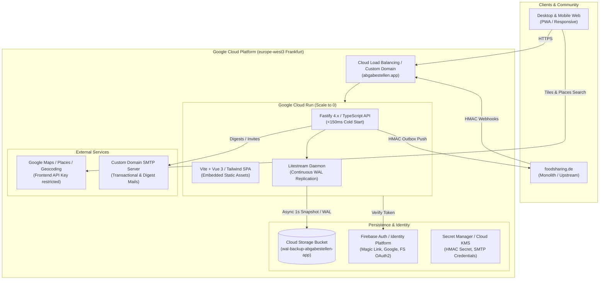
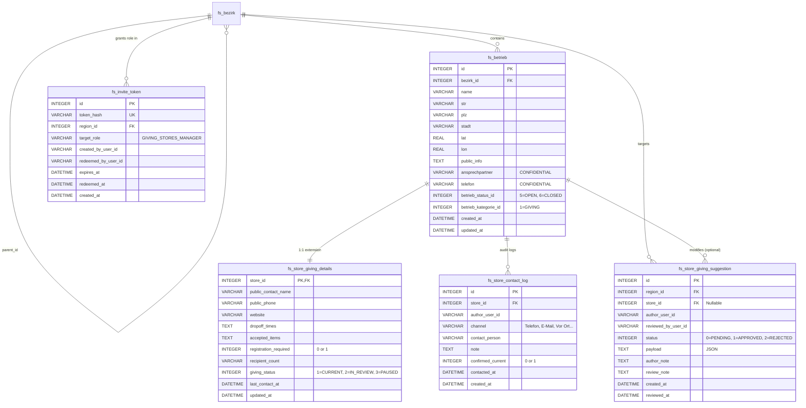
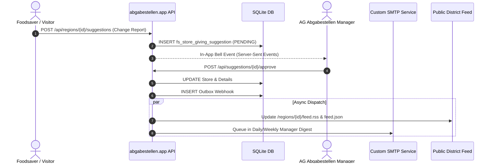

# ARCHITECTURE.md — abgabestellen.app

**Platform:** Standalone Multi-Region Drop-Off Points Platform (*Abgabestellen & Soziale Einrichtungen*)  
**Target Environment:** Google Cloud Run (`europe-west3`, Frankfurt)  
**Repository:** [github.com/fuchstv/abgabestellen.app](https://github.com/fuchstv/abgabestellen.app)  
**Compatibility Target:** `foodsharing-dev/foodsharing` (Monolith Branch `2996-drop-off-points-giving-stores`, MR !5773)  
**Status:** Certified Architecture & Production Blueprint  

---

## 1. Executive Summary & Design Mandates

`abgabestellen.app` is an independent, high-performance web platform designed to map and coordinate food drop-off points, soup kitchens, community pantries, and social welfare institutions.

### Core Strategic Mandates
1. **100% Standalone Readiness:** Operates out-of-the-box across multiple cities (starting with Berlin and its 12 administrative districts), without hard runtime dependencies on `foodsharing.de`.
2. **Zero-Drift Monolith Schema Compatibility:** Preserves 1:1 data model and column semantics (`fs_betrieb`, `fs_bezirk`, `fs_store_giving_details`, `fs_store_giving_suggestion`, `fs_store_contact_log`). Field types, naming, JSON payloads, and validation constraints mirror upstream PHP/Doctrine migrations identically.
3. **0€ Idle Cost & Near-Zero Cold Starts:** Leverages Google Cloud Run scale-to-zero container execution paired with a persistent, highly-available SQLite engine replicated to Google Cloud Storage via Litestream. Cold boot time is under 150ms with sub-50MB RAM consumption.
4. **GDPR-Compliant Zero-PII Volunteer Elevation:** Avoids mass synchronization of sensitive member records from upstream databases. Volunteers authenticate via Firebase Auth / Identity Platform; elevated privileges (`FOODSAVER+`, `GIVING_STORES_MANAGER`) are granted using cryptographically signed one-time invite tokens created by district coordinators with double opt-in.
5. **Bidirectional Federation & Event-Driven Bridge:** Maintains an append-only outbox and signed HMAC-SHA256 webhook bridge to synchronize store changes, status toggles, and community suggestions with `foodsharing.de` or federated partner platforms.

---

## 2. System Topology & Cloud Infrastructure



### 2.1 Component Specifications
- **Cloud Run Service:** `abgabestellen-web` deployed in `europe-west3` (min-instances: `0`, max-instances: `5`, CPU: `1`, Memory: `512MiB`, execution-environment: `gen2`).
- **Persistence:** SQLite database file hosted on a fast local NVMe tmpfs/directory, with continuous streaming write-ahead log (WAL) synchronization to a Cloud Storage bucket (`wal-backup-abgabestellen-app`) using Litestream.
- **Frontend Delivery:** Pre-compiled Vue 3 + Tailwind CSS + Lucide icons bundled directly with the Fastify static server (distroless container image ~35MB).
- **Google Maps Integration:**
  - Client-side Maps JavaScript API + Places API + Geocoding API.
  - API Key: Configured via environment secret `${VITE_GOOGLE_MAPS_API_KEY}`.
  - HTTP Referrer Restrictions: `https://abgabestellen.app/*`, `https://*.abgabestellen.app/*`, `http://localhost:*/*`.

---

## 3. Canonical Database Schema (SQLite / MySQL 1:1 Mapping)

The database schema directly maps the relational entities of `foodsharing-dev/foodsharing` to ensure full payload and query equivalence.



### 3.1 DDL Implementation (SQLite with Strict Mode)

```sql
PRAGMA foreign_keys = ON;

-- 1. REGIONS HIERARCHY (Standalone & sync-ready)
CREATE TABLE IF NOT EXISTS `fs_bezirk` (
  `id` INTEGER PRIMARY KEY AUTOINCREMENT,
  `parent_id` INTEGER NULL REFERENCES `fs_bezirk`(`id`) ON DELETE SET NULL,
  `name` TEXT NOT NULL,
  `type` INTEGER NOT NULL DEFAULT 1, -- 1=City/State, 2=District, 3=Kiez
  `lat` REAL NULL,
  `lon` REAL NULL,
  `external_fs_bezirk_id` INTEGER NULL UNIQUE,
  `created_at` TEXT NOT NULL DEFAULT (CURRENT_TIMESTAMP)
);
CREATE INDEX IF NOT EXISTS `idx_fs_bezirk_parent` ON `fs_bezirk`(`parent_id`);
CREATE INDEX IF NOT EXISTS `idx_fs_bezirk_external` ON `fs_bezirk`(`external_fs_bezirk_id`);

-- 2. BASE STORE / DROP-OFF ENTITY (Mirrors fs_betrieb)
CREATE TABLE IF NOT EXISTS `fs_betrieb` (
  `id` INTEGER PRIMARY KEY AUTOINCREMENT,
  `bezirk_id` INTEGER NOT NULL REFERENCES `fs_bezirk`(`id`),
  `name` TEXT NOT NULL,
  `str` TEXT NOT NULL DEFAULT '',
  `plz` TEXT NOT NULL DEFAULT '',
  `stadt` TEXT NOT NULL DEFAULT '',
  `lat` REAL NOT NULL DEFAULT 0.0,
  `lon` REAL NOT NULL DEFAULT 0.0,
  `public_info` TEXT NOT NULL DEFAULT '',
  `ansprechpartner` TEXT NOT NULL DEFAULT '', -- STRICTLY INTERNAL CONFIDENTIAL
  `telefon` TEXT NOT NULL DEFAULT '',          -- STRICTLY INTERNAL CONFIDENTIAL
  `betrieb_status_id` INTEGER NOT NULL DEFAULT 5, -- 5=COOPERATION, 6=CLOSED
  `betrieb_kategorie_id` INTEGER NOT NULL DEFAULT 1, -- 1=GIVING
  `external_fs_betrieb_id` INTEGER NULL UNIQUE,
  `created_at` TEXT NOT NULL DEFAULT (CURRENT_TIMESTAMP),
  `updated_at` TEXT NOT NULL DEFAULT (CURRENT_TIMESTAMP)
);
CREATE INDEX IF NOT EXISTS `idx_fs_betrieb_bezirk` ON `fs_betrieb`(`bezirk_id`);
CREATE INDEX IF NOT EXISTS `idx_fs_betrieb_geo` ON `fs_betrieb`(`lat`, `lon`);

-- 3. GIVING EXTENSION TABLE (1:1 with fs_store_giving_details)
CREATE TABLE IF NOT EXISTS `fs_store_giving_details` (
  `store_id` INTEGER PRIMARY KEY REFERENCES `fs_betrieb`(`id`) ON DELETE CASCADE,
  `public_contact_name` TEXT NOT NULL DEFAULT '',
  `public_phone` TEXT NOT NULL DEFAULT '',
  `website` TEXT NOT NULL DEFAULT '',
  `dropoff_times` TEXT NULL DEFAULT NULL,
  `accepted_items` TEXT NULL DEFAULT NULL,
  `registration_required` INTEGER NOT NULL DEFAULT 0, -- 0 or 1
  `recipient_count` TEXT NOT NULL DEFAULT '',
  `giving_status` INTEGER NOT NULL DEFAULT 1, -- 1=CURRENT, 2=IN_REVIEW, 3=PAUSED
  `last_contact_at` TEXT NULL DEFAULT NULL,
  `updated_at` TEXT NOT NULL DEFAULT (CURRENT_TIMESTAMP)
);
CREATE INDEX IF NOT EXISTS `idx_fs_giving_status` ON `fs_store_giving_details`(`giving_status`);
CREATE INDEX IF NOT EXISTS `idx_fs_giving_reg` ON `fs_store_giving_details`(`registration_required`);
CREATE INDEX IF NOT EXISTS `idx_fs_giving_last_contact` ON `fs_store_giving_details`(`last_contact_at`);

-- 4. COMMUNITY SUGGESTIONS & REVIEWS (Mirrors fs_store_giving_suggestion)
CREATE TABLE IF NOT EXISTS `fs_store_giving_suggestion` (
  `id` INTEGER PRIMARY KEY AUTOINCREMENT,
  `region_id` INTEGER NOT NULL REFERENCES `fs_bezirk`(`id`),
  `store_id` INTEGER NULL REFERENCES `fs_betrieb`(`id`) ON DELETE SET NULL,
  `author_user_id` TEXT NOT NULL,
  `author_email` TEXT NOT NULL DEFAULT '',
  `reviewed_by_user_id` TEXT NULL,
  `status` INTEGER NOT NULL DEFAULT 0, -- 0=PENDING, 1=APPROVED, 2=REJECTED
  `payload` TEXT NOT NULL, -- JSON string GivingStoreSuggestionPayload
  `author_note` TEXT NULL,
  `review_note` TEXT NULL,
  `created_at` TEXT NOT NULL DEFAULT (CURRENT_TIMESTAMP),
  `reviewed_at` TEXT NULL
);
CREATE INDEX IF NOT EXISTS `idx_fs_suggestion_region_status` ON `fs_store_giving_suggestion`(`region_id`, `status`);
CREATE INDEX IF NOT EXISTS `idx_fs_suggestion_store` ON `fs_store_giving_suggestion`(`store_id`);

-- 5. AUDIT & CONTACT LOG (Mirrors fs_store_contact_log)
CREATE TABLE IF NOT EXISTS `fs_store_contact_log` (
  `id` INTEGER PRIMARY KEY AUTOINCREMENT,
  `store_id` INTEGER NOT NULL REFERENCES `fs_betrieb`(`id`) ON DELETE CASCADE,
  `author_user_id` TEXT NOT NULL,
  `author_name` TEXT NOT NULL DEFAULT '',
  `channel` TEXT NOT NULL DEFAULT 'Telefon', -- Telefon, E-Mail, Vor Ort, Messenger
  `contact_person` TEXT NOT NULL DEFAULT '',
  `note` TEXT NOT NULL,
  `confirmed_current` INTEGER NOT NULL DEFAULT 0, -- 0 or 1
  `contacted_at` TEXT NOT NULL,
  `created_at` TEXT NOT NULL DEFAULT (CURRENT_TIMESTAMP)
);
CREATE INDEX IF NOT EXISTS `idx_fs_contact_store` ON `fs_store_contact_log`(`store_id`, `contacted_at`);

-- 6. REGION CLOSURE TABLE (Accelerates deep tree traversal)
CREATE TABLE IF NOT EXISTS `fs_bezirk_closure` (
  `ancestor_id` INTEGER NOT NULL REFERENCES `fs_bezirk`(`id`) ON DELETE CASCADE,
  `descendant_id` INTEGER NOT NULL REFERENCES `fs_bezirk`(`id`) ON DELETE CASCADE,
  `depth` INTEGER NOT NULL DEFAULT 0,
  PRIMARY KEY (`ancestor_id`, `descendant_id`)
);

-- 7. ZERO-PII CRYPTOGRAPHIC INVITE TOKENS (GDPR role elevation)
CREATE TABLE IF NOT EXISTS `fs_invite_token` (
  `id` INTEGER PRIMARY KEY AUTOINCREMENT,
  `token_hash` TEXT NOT NULL UNIQUE,
  `region_id` INTEGER NOT NULL REFERENCES `fs_bezirk`(`id`),
  `target_role` TEXT NOT NULL DEFAULT 'GIVING_STORES_MANAGER',
  `created_by_user_id` TEXT NOT NULL,
  `redeemed_by_user_id` TEXT NULL,
  `expires_at` TEXT NOT NULL,
  `redeemed_at` TEXT NULL,
  `created_at` TEXT NOT NULL DEFAULT (CURRENT_TIMESTAMP)
);

-- 8. LOCAL USER ROLES & REGION ASSIGNMENTS
CREATE TABLE IF NOT EXISTS `fs_user_roles` (
  `user_id` TEXT NOT NULL, -- Firebase UID
  `region_id` INTEGER NOT NULL REFERENCES `fs_bezirk`(`id`) ON DELETE CASCADE,
  `role` TEXT NOT NULL, -- FOODSAVER_PLUS, GIVING_STORES_MANAGER, REGION_ADMIN, SUPERADMIN
  `created_at` TEXT NOT NULL DEFAULT (CURRENT_TIMESTAMP),
  PRIMARY KEY (`user_id`, `region_id`, `role`)
);
CREATE INDEX IF NOT EXISTS `idx_user_roles_lookup` ON `fs_user_roles`(`user_id`);

-- 9. EVENT OUTBOX (For reliable webhook dispatch & federation)
CREATE TABLE IF NOT EXISTS `fs_event_outbox` (
  `id` INTEGER PRIMARY KEY AUTOINCREMENT,
  `event_id` TEXT NOT NULL UNIQUE,
  `event_type` TEXT NOT NULL,
  `payload` TEXT NOT NULL,
  `status` INTEGER NOT NULL DEFAULT 0, -- 0=PENDING, 1=SENT, 2=FAILED
  `retry_count` INTEGER NOT NULL DEFAULT 0,
  `next_retry_at` TEXT NOT NULL DEFAULT (CURRENT_TIMESTAMP),
  `created_at` TEXT NOT NULL DEFAULT (CURRENT_TIMESTAMP)
);
```

---

## 4. Multi-Region Hierarchy & Upward Traversal Permission Engine

Berlin has 12 Bezirke (Pankow, Mitte, Neukölln, etc.) grouped under the parent Landesbezirk Berlin. In the future, additional municipalities (Hamburg, Köln, Leipzig) join the platform.

### 4.1 Upward Permission Inheritance Rule
If a volunteer holds `GIVING_STORES_MANAGER` or `REGION_ADMIN` in a parent region (e.g. *Berlin (Landesbezirk)* with ID `1`), they automatically possess management and review authorization over all descendant districts (e.g., *Mitte* ID `10`, *Pankow* ID `11`).

```
Berlin (Landesbezirk, ID 1) [AG Abgabestellen Berlin Manager]
├── Mitte (ID 10)            --> Inherited Manager
├── Pankow (ID 11)           --> Inherited Manager
│   └── Prenzlauer Berg (ID 111) --> Inherited Manager
└── Neukölln (ID 12)        --> Inherited Manager
```

### 4.2 Recursive Permission Check Algorithm
```typescript
export async function mayManageGivingStoresInRegion(
  db: Database,
  userId: string,
  targetRegionId: number,
  isSuperAdmin: boolean = false
): Promise<boolean> {
  if (isSuperAdmin) return true;

  // Single fast CTE upward traversal query in SQLite
  const row = db.prepare(`
    WITH RECURSIVE RegionTree AS (
      SELECT id, parent_id FROM fs_bezirk WHERE id = ?
      UNION ALL
      SELECT b.id, b.parent_id FROM fs_bezirk b
      JOIN RegionTree rt ON b.id = rt.parent_id
    )
    SELECT 1 FROM fs_user_roles ur
    JOIN RegionTree rt ON ur.region_id = rt.id
    WHERE ur.user_id = ? 
      AND ur.role IN ('GIVING_STORES_MANAGER', 'REGION_ADMIN', 'SUPERADMIN')
    LIMIT 1;
  `).get(targetRegionId, userId);

  return !!row;
}
```

---

## 5. Authentication, Privacy & GDPR Zero-PII Role Onboarding

### 5.1 Privacy & Confidentiality Separation
- **Public Surface (Visitors & Regular Foodsavers):**
  - Name, address, coordinates, public arrival notes (`public_info`).
  - Drop-off times (`dropoff_times`), accepted goods (`accepted_items`).
  - Public contact name (`public_contact_name`), public phone (`public_phone`), website (`website`).
  - Registration toggle (`registration_required`), status badges (`giving_status`).
- **Internal Surface (Gated to `GIVING_STORES_MANAGER` & Admins):**
  - Internal staff contact (`ansprechpartner`) — **never rendered to public / anonymous users**.
  - Direct coordinator phone (`telefon`) — **never rendered to public / anonymous users**.
  - Full audit history of calls & visits (`fs_store_contact_log`) — **never rendered to public / anonymous users**.
  - Last contacted verification timestamp (`last_contact_at`).

### 5.2 Zero-PII Role Elevation via Cryptographic Invite Tokens
To avoid transporting personal user tables or GDPR compliance burdens from `foodsharing.de`:
1. An existing District Coordinator generates an **Invite Link** for their region in the Admin UI:
   `https://abgabestellen.app/invite/{token}`
2. The server generates a high-entropy random token (`crypto.randomBytes(32).toString('hex')`), hashes it with SHA-256 for database storage (`fs_invite_token`), and sets a 7-day expiration.
3. The new volunteer authenticates (Firebase Auth Email Link or Google SSO).
4. Redeeming the invite verifies the token, records the user's Firebase UID into `fs_user_roles`, and marks the token consumed.
5. No passwords, addresses, or external member identifiers are required or retained.

---

## 6. Notification Center & District Feed Subsystems

Replacing `foodsharing` forum auto-threads (`GIVING_STORES_UPDATES`) and user inbox bells:



### 6.1 In-App Notification Center
- Built using Server-Sent Events (`GET /api/notifications/stream`) with automatic reconnection and fallback to polling.
- Managers see unread badges when suggestions in their region tree are pending review.

### 6.2 Transactional & Digest Emails (Custom Domain SMTP)
- **Immediate Alerts (Opt-in):** Direct notification on critical changes (e.g. store reported permanently closed).
- **Weekly Coordination Digest:** Summary sent Monday morning detailing:
  - Drop-off points needing periodic verification (ordered by `last_contact_at IS NULL` first).
  - Suggestions approved/rejected in their district over the last 7 days.

### 6.3 Public District Feeds
- **GeoJSON Feed:** `GET /api/regions/{id}/places.geojson` for easy consumption by local community apps.
- **RSS/Atom Feed:** `GET /api/regions/{id}/feed.xml` publishing new drop-off points, schedule changes, and seasonal pauses.

---

## 7. Bidirectional REST & Webhook Synchronization Protocol

### 7.1 Security & Idempotency Specification
- **HMAC Signature Header:** `X-Abgabestellen-Signature: sha256=<hex_hmac>`
- **Delivery Header:** `X-Abgabestellen-Delivery: <uuid_v4>`
- **Replay Protection:** Receiver rejects payloads if `abs(now - timestamp) > 300` seconds.
- **Conflict Resolution:** Last-Write-Wins (LWW) evaluated using ISO 8601 UTC `updated_at`.

### 7.2 Event Catalog
| Event Key | Trigger Condition | Target Action |
| :--- | :--- | :--- |
| `giving_store.created` | New drop-off point approved | Upsert `fs_betrieb` + `fs_store_giving_details` |
| `giving_store.updated` | Address, schedule, or accepted items updated | Update fields; check LWW timestamp |
| `giving_store.status_changed` | Toggled between CURRENT, IN_REVIEW, PAUSED | Update `fs_store_giving_details.giving_status` |
| `giving_store.suggestion_created` | Community change proposal submitted | Create pending review suggestion |
| `giving_store.contact_logged` | Phone call or on-site verification recorded | Insert `fs_store_contact_log`, update `last_contact_at` |

---

## 8. Deployment, CI/CD & Operations Blueprint

### 8.1 Google Cloud Artifacts & Resources
- **GCP Production Project:** `abgabestellen-app-prod` (Project Number: `1087619962477`)
- **Firebase Project:** `abgabestellen-app` / `abgabestellen-app-prod`
- **Cloud Run Region:** `europe-west3` (Frankfurt)
- **Cloud Storage Bucket:** `wal-backup-abgabestellen-app`
- **Maps API Key:** Configured via Secret Manager / Environment variable `VITE_GOOGLE_MAPS_API_KEY` (Restricted to `https://abgabestellen.app/*`, `https://*.abgabestellen.app/*`, `http://localhost:*/*`)
- **Docker Container:** Distroless Node.js runtime with Litestream WAL replication.

### 8.2 Litestream Replication Configuration (`litestream.yml`)
```yaml
dbs:
  - path: /data/abgabestellen.db
    replicas:
      - type: gcs
        bucket: wal-backup-abgabestellen-app
        path: db
        retention: 720h # 30 days
```

### 8.3 Cold-Start Optimization Strategy
1. **Zero External DB Roundtrips on Boot:** SQLite is mounted locally in container filesystem. Reads execute in <1ms without connection pooling latency.
2. **Distroless Container:** Multi-stage build strips dev dependencies and source maps; image size <60MB.
3. **Lazy SDK Initialization:** Firebase Auth and Google client libraries are lazily resolved on first use.

---

## 9. Next Steps: Scaffolding Phase
1. Initial repository structure (`/src/server`, `/src/client`, `/src/shared`).
2. Database schema migrations and seed scripts for Berlin and its 12 Bezirke.
3. Fastify server setup with JSON schema validators matching `GivingStoreDetails` and `GivingStoreSuggestionPayload`.
4. Vue 3 map view with Google Maps and filter toggle (*„Ohne vorherige telefonische Anmeldung“*).
5. GitHub Actions workflow to build, test, and deploy to Google Cloud Run (`europe-west3`).
