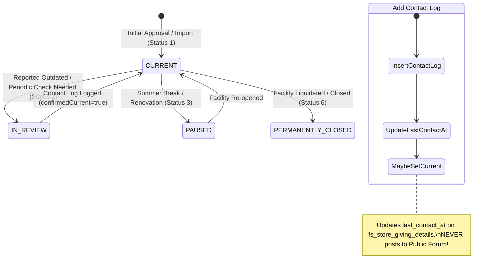

# HANDOFF_GIVING_STORES.md
## Forensic Feature Extraction & Specification: GIVING Stores (Abgabestellen)

**Target Standalone Application:** `abgabestellen.app` (Google Cloud Run)  
**Origin Codebase:** `foodsharing` Monolith (Branch `2996-drop-off-points-giving-stores`, MR !5773, Follow-up to #810, Companion to #2995) & `fuchstv/Abgabestellen`  
**Integration Pattern:** Standalone Multi-Region Web Application with Bidirectional HMAC-Signed REST/Webhook Bridge to `foodsharing.de`

---

## 1. Executive Summary & Extraction Scope

This document provides the complete forensic specification to extract the **GIVING Stores (Abgabestellen / Drop-Off Points)** domain from the `foodsharing` monolith into an independent, multi-region web application (`abgabestellen.app`).

### Key Objectives
1. **1:1 Data Model Compatibility:** Preserve table structures, column naming, and semantics (`fs_store_giving_details`, `fs_store_giving_suggestion`, `fs_store_contact_log`) so that `abgabestellen.app` and `foodsharing.de` can exchange entities without schema translation layers.
2. **Strict Public vs. Internal Data Boundary:** Public visitors and foodsavers can view drop-off hours, accepted goods, public contacts, and website links, but internal contact persons (`ansprechpartner`), coordinator direct phones, and internal contact logs (`fs_store_contact_log`) are strictly restricted to authenticated managers (`GIVING_STORES_MANAGER` / `GOALS-AG` / `ORGA`).
3. **Region Hierarchy & Upward Traversal:** Multi-region permission inheritance allows regional working groups (e.g., *AG Abgabestellen Berlin* on parent region Berlin) to manage all nested districts (e.g., Mitte, Pankow, Neukölln).
4. **Event-Driven Synchronization Bridge:** Two-way synchronization between `abgabestellen.app` and `foodsharing.de` via signed REST webhooks to keep regional forum auto-threads (`GIVING_STORES_UPDATES`), map filters, and bell notifications in sync.

---

## 2. Canonical SQL DDL & Schemas

The database schema directly mirrors the production migration `20261024160000_add_giving_store_details_and_workflows.php` and its companion store fields from `fs_betrieb`.

### 2.1 MySQL / MariaDB DDL

```sql
-- ============================================================================
-- 1. DROP-OFF POINT EXTENSION TABLE: fs_store_giving_details
-- 1:1 extension table attached to a Store / Place entity
-- ============================================================================
CREATE TABLE `fs_store_giving_details` (
  `store_id` INT UNSIGNED NOT NULL COMMENT 'References fs_betrieb.id or standalone place ID',
  `public_contact_name` VARCHAR(120) NOT NULL DEFAULT '' COMMENT 'Public coordinator/reception contact name',
  `public_phone` VARCHAR(60) NOT NULL DEFAULT '' COMMENT 'Public phone number for food donors/savers',
  `website` VARCHAR(255) NOT NULL DEFAULT '' COMMENT 'Public website URL or social media link',
  `dropoff_times` TEXT NULL DEFAULT NULL COMMENT 'Freeform multiline schedule when food drop-offs are accepted',
  `accepted_items` TEXT NULL DEFAULT NULL COMMENT 'Freeform multiline list of accepted food goods and criteria',
  `registration_required` TINYINT(1) NOT NULL DEFAULT 0 COMMENT '0 = Drop-off without prior notice; 1 = Phone registration required',
  `recipient_count` VARCHAR(120) NOT NULL DEFAULT '' COMMENT 'Approximate daily/weekly recipients (e.g. ca. 80 Personen)',
  `giving_status` TINYINT UNSIGNED NOT NULL DEFAULT 1 COMMENT '1 = CURRENT (Aktuell), 2 = IN_REVIEW (In Aktualisierung), 3 = PAUSED (Außer Betrieb)',
  `last_contact_at` DATETIME NULL DEFAULT NULL COMMENT 'Timestamp when information was last verified with the organization',
  `updated_at` DATETIME NULL DEFAULT NULL COMMENT 'Timestamp of last details update',
  PRIMARY KEY (`store_id`),
  INDEX `idx_giving_status` (`giving_status`),
  INDEX `idx_registration_required` (`registration_required`),
  INDEX `idx_last_contact_at` (`last_contact_at`)
) ENGINE=InnoDB DEFAULT CHARSET=utf8mb4 COLLATE=utf8mb4_unicode_ci;

-- ============================================================================
-- 2. SUGGESTIONS & CHANGE REPORTS: fs_store_giving_suggestion
-- Community submissions for new drop-off points or edits to existing ones
-- ============================================================================
CREATE TABLE `fs_store_giving_suggestion` (
  `id` INT UNSIGNED NOT NULL AUTO_INCREMENT,
  `region_id` INT UNSIGNED NOT NULL COMMENT 'Target geographic region ID (fs_bezirk.id)',
  `store_id` INT UNSIGNED NULL DEFAULT NULL COMMENT 'NULL for new places; existing ID when reporting changes',
  `author_fs_id` INT UNSIGNED NOT NULL COMMENT 'Submitting Foodsaver user ID (fs_foodsaver.id)',
  `reviewed_by_fs_id` INT UNSIGNED NULL DEFAULT NULL COMMENT 'Reviewing Manager user ID (fs_foodsaver.id)',
  `status` TINYINT UNSIGNED NOT NULL DEFAULT 0 COMMENT '0 = PENDING, 1 = APPROVED, 2 = REJECTED',
  `payload` MEDIUMTEXT NOT NULL COMMENT 'JSON-encoded GivingStoreSuggestionPayload',
  `author_note` TEXT NULL DEFAULT NULL COMMENT 'Optional message from author describing source/context',
  `review_note` TEXT NULL DEFAULT NULL COMMENT 'Internal note by reviewer explaining decision or edits',
  `created_at` DATETIME NOT NULL COMMENT 'Submission timestamp',
  `reviewed_at` DATETIME NULL DEFAULT NULL COMMENT 'Review decision timestamp',
  PRIMARY KEY (`id`),
  INDEX `idx_region_status_created` (`region_id`, `status`, `created_at`),
  INDEX `idx_store_status` (`store_id`, `status`),
  INDEX `idx_author_fs_id` (`author_fs_id`)
) ENGINE=InnoDB DEFAULT CHARSET=utf8mb4 COLLATE=utf8mb4_unicode_ci;

-- ============================================================================
-- 3. INTERNAL CONTACT & VERIFICATION LOG: fs_store_contact_log
-- Audit log of direct staff calls, visits, and verifications
-- ============================================================================
CREATE TABLE `fs_store_contact_log` (
  `id` INT UNSIGNED NOT NULL AUTO_INCREMENT,
  `store_id` INT UNSIGNED NOT NULL COMMENT 'Target drop-off store ID (fs_betrieb.id)',
  `author_fs_id` INT UNSIGNED NOT NULL COMMENT 'Manager who conducted the contact attempt',
  `channel` VARCHAR(32) NOT NULL DEFAULT '' COMMENT 'Contact channel: Telefon, E-Mail, Vor Ort, Messenger, Sonstiges',
  `contact_person` VARCHAR(120) NOT NULL DEFAULT '' COMMENT 'Name/role of staff person spoken to at the facility',
  `note` TEXT NOT NULL COMMENT 'Detailed log of conversation, capacity, seasonal pauses',
  `confirmed_current` TINYINT(1) NOT NULL DEFAULT 0 COMMENT 'Whether the facility confirmed drop-off data is current',
  `contacted_at` DATETIME NOT NULL COMMENT 'Actual wall-clock date/time when contact took place',
  `created_at` DATETIME NOT NULL COMMENT 'Record creation timestamp',
  PRIMARY KEY (`id`),
  INDEX `idx_store_contacted_at` (`store_id`, `contacted_at`),
  INDEX `idx_author_fs_id` (`author_fs_id`)
) ENGINE=InnoDB DEFAULT CHARSET=utf8mb4 COLLATE=utf8mb4_unicode_ci;

-- ============================================================================
-- 4. COMPANION STORE ATTRIBUTES (fs_betrieb bridge reference)
-- Fields required in base store / place entity for complete operation
-- ============================================================================
-- `id` INT UNSIGNED PRIMARY KEY
-- `name` VARCHAR(150) NOT NULL
-- `str` VARCHAR(150) NOT NULL (Street & number)
-- `plz` VARCHAR(16) NOT NULL (Postal code)
-- `stadt` VARCHAR(100) NOT NULL (City / Town)
-- `lat` DOUBLE NOT NULL (Latitude WGS84)
-- `lon` DOUBLE NOT NULL (Longitude WGS84)
-- `public_info` VARCHAR(520) NOT NULL DEFAULT '' (Public arrival notes, gate instructions)
-- `ansprechpartner` VARCHAR(150) NOT NULL DEFAULT '' [STRICTLY INTERNAL CONFIDENTIAL]
-- `telefon` VARCHAR(60) NOT NULL DEFAULT '' [STRICTLY INTERNAL CONFIDENTIAL FOR GIVING STORES]
-- `betrieb_status_id` INT NOT NULL DEFAULT 5 (5 = COOPERATION_ESTABLISHED, 6 = PERMANENTLY_CLOSED)
-- `betrieb_kategorie_id` INT NOT NULL (Links to category with type = 1 / GIVING)
```

---

## 3. JSON Schemas (Draft 2020-12)

### 3.1 `GivingStoreDetails` Schema
```json
{
  "$schema": "https://json-schema.org/draft/2020-12/schema",
  "$id": "https://abgabestellen.app/schemas/GivingStoreDetails.json",
  "title": "GivingStoreDetails",
  "type": "object",
  "properties": {
    "publicContactName": { "type": "string", "maxLength": 120 },
    "publicPhone": { "type": "string", "maxLength": 60 },
    "website": { "type": "string", "maxLength": 255 },
    "dropoffTimes": { "type": ["string", "null"], "maxLength": 5000 },
    "acceptedItems": { "type": ["string", "null"], "maxLength": 5000 },
    "registrationRequired": { "type": "boolean" },
    "recipientCount": { "type": "string", "maxLength": 120 },
    "givingStatus": {
      "type": "integer",
      "enum": [1, 2, 3],
      "description": "1 = CURRENT, 2 = IN_REVIEW, 3 = PAUSED"
    },
    "lastContactAt": {
      "type": ["string", "null"],
      "format": "date-time",
      "description": "ISO 8601 UTC. Gated to managers only."
    }
  },
  "required": [
    "publicContactName",
    "publicPhone",
    "website",
    "registrationRequired",
    "recipientCount",
    "givingStatus"
  ]
}
```

### 3.2 `GivingStoreSuggestionPayload` Schema
Used inside `fs_store_giving_suggestion.payload` and during REST suggestion submissions. Supports mapping from legacy German CSV/spreadsheet imports (`fuchstv/Abgabestellen`).

```json
{
  "$schema": "https://json-schema.org/draft/2020-12/schema",
  "$id": "https://abgabestellen.app/schemas/GivingStoreSuggestionPayload.json",
  "title": "GivingStoreSuggestionPayload",
  "type": "object",
  "properties": {
    "name": { "type": ["string", "null"], "maxLength": 150 },
    "street": { "type": ["string", "null"], "maxLength": 150 },
    "postalCode": { "type": ["string", "null"], "maxLength": 16 },
    "city": { "type": ["string", "null"], "maxLength": 100 },
    "lat": { "type": ["number", "null"], "minimum": -90, "maximum": 90 },
    "lon": { "type": ["number", "null"], "minimum": -180, "maximum": 180 },
    "publicInfo": { "type": ["string", "null"], "maxLength": 2000 },
    "publicContactName": { "type": ["string", "null"], "maxLength": 120 },
    "publicPhone": { "type": ["string", "null"], "maxLength": 60 },
    "website": { "type": ["string", "null"], "maxLength": 255 },
    "dropoffTimes": { "type": ["string", "null"], "maxLength": 5000 },
    "acceptedItems": { "type": ["string", "null"], "maxLength": 5000 },
    "registrationRequired": { "type": ["boolean", "null"] },
    "recipientCount": { "type": ["string", "null"], "maxLength": 120 },
    "givingStatus": { "type": ["integer", "null"], "enum": [1, 2, 3] },
    "permanentlyClosed": { "type": ["boolean", "null"] },
    "internalContactName": {
      "type": ["string", "null"],
      "maxLength": 150,
      "description": "Internal staff contact. Stripped unless author has manager permissions."
    }
  },
  "additionalProperties": false
}
```

### 3.3 CSV Column Alias Mapping Table (`fuchstv/Abgabestellen` compatibility)

When importing CSV/Excel rows or receiving external feeds, headers are normalized (`preg_replace('/[^a-z0-9äöüß]/u', '', mb_strtolower($header))`):

| Target Field | Accepted Column Headers / Spreadsheet Keys |
| :--- | :--- |
| `name` | `name`, `namederabgabestelle`, `betrieb`, `abgabestelle` |
| `street` | `street`, `str`, `strasse`, `straße`, `anschrift`, `anschriftstraßenr`, `adresse` |
| `postalCode` | `postalcode`, `plz`, `zip`, `postleitzahl` |
| `city` | `city`, `stadt`, `ort`, `ortsteil` |
| `lat` / `lon` | `lat`/`lon`, `latitude`/`longitude`, `breitengrad`/`längengrad`, `laengengrad` |
| `publicContactName` | `publiccontactname`, `ansprechpartner`, `ansprechperson`, `ansprechpersonöffentlich`, `kontakt` |
| `publicPhone` | `publicphone`, `telefon`, `phone`, `tel` |
| `website` | `website`, `webseite`, `url`, `homepage` |
| `dropoffTimes` | `dropofftimes`, `annahmezeiten`, `abgabezeiten`, `wannkönnenlebensmittelabgegebenwerden`, `oeffnungszeiten`, `öffnungszeiten` |
| `acceptedItems` | `accepteditems`, `akzeptiert`, `waswirdangenommen`, `lebensmittel` |
| `recipientCount` | `recipientcount`, `anzahlabnehmer`, `anzahlabnehmerinnen` |
| `publicInfo` | `publicinfo`, `bemerkungen`, `hinweise`, `beschreibung` |
| `internalContactName`| `internalcontactname`, `ansprechpartnerintern`, `intern` |
| `registrationRequired`| `registrationrequired`, `anmeldungnoetig`, `anmeldungnötig`, `voranmeldung`, `vorherigetelefonischeanmeldungnötig` (Truthy: `1`, `true`, `ja`, `yes`, `j`, `y`, `x`) |
| `givingStatus` | `givingstatus`, `status` (`1`/`aktuell` -> 1; `2`/`prüfung`/`in_review` -> 2; `3`/`inaktiv`/`paused` -> 3; `geschlossen`/`closed`/`4` -> `permanentlyClosed = true`) |

---

## 4. RBAC & Permission Matrix

A critical design requirement is the **strict separation between public drop-off information and internal coordination records**.

### 4.1 Permission Matrix

| Capability / Resource | Public Visitor | Foodsaver+ (SSO) | Store Manager (Specific) | GIVING_STORES_MANAGER (AG Abgabestellen) | Region Ambassador (BOT) | Global ORGA |
| :--- | :---: | :---: | :---: | :---: | :---: | :---: |
| **View Map Markers & Bubbles** | ✅ | ✅ | ✅ | ✅ | ✅ | ✅ |
| **Filter "Without Registration"** | ✅ | ✅ | ✅ | ✅ | ✅ | ✅ |
| **View Store Public Details Card** | ✅ | ✅ | ✅ | ✅ | ✅ | ✅ |
| **View Store Pinboard / Wall** | ❌ | ✅ | ✅ | ✅ | ✅ | ✅ |
| **Post on Store Pinboard** | ❌ | ✅ | ✅ | ✅ | ✅ | ✅ |
| **Submit Change Report / Suggestion** | ❌ | ✅ | ✅ | ✅ | ✅ | ✅ |
| **Direct PATCH Giving Details** | ❌ | ❌ | ✅ (Own store) | ✅ (Region tree) | ✅ (Region) | ✅ |
| **View Internal Contact (`ansprechpartner`)**| ❌ | ❌ | ✅ (Own store) | ✅ (Region tree) | ✅ (Region) | ✅ |
| **View Internal Phone (`telefon`)** | ❌ | ❌ | ✅ (Own store) | ✅ (Region tree) | ✅ (Region) | ✅ |
| **View `fs_store_contact_log`** | ❌ | ❌ | ✅ (Own store) | ✅ (Region tree) | ✅ (Region) | ✅ |
| **Add `fs_store_contact_log` Entry**| ❌ | ❌ | ✅ (Own store) | ✅ (Region tree) | ✅ (Region) | ✅ |
| **View Maintenance List (`/maintenance`)** | ❌ | ❌ | ❌ | ✅ (Region tree) | ✅ (Region) | ✅ |
| **Approve / Reject Suggestions** | ❌ | ❌ | ✅ (Own store change)| ✅ (Region tree) | ✅ (Region) | ✅ |
| **Execute CSV / JSON Bulk Import** | ❌ | ❌ | ❌ | ✅ (Region tree) | ✅ (Region) | ✅ |
| **Configure Forum Auto-Threads** | ❌ | ❌ | ❌ | ✅ (Region tree) | ✅ (Region) | ✅ |

### 4.2 Upward Region Ancestor Traversal Algorithm

When determining if a user has management permissions over a drop-off store in region `R` (e.g., `Bezirk Mitte` with ID 42):
```
function mayManageGivingStoresInRegion(userId, regionId):
    1. If user.hasRole(ORGA): return true
    2. If user.isAmbassadorForRegion(regionId): return true
    3. currentRegion = regionId
    4. While currentRegion is not NULL:
         a. If user.isAdminOfWorkgroupWithFunction(currentRegion, WorkgroupFunction::GIVING_STORES [14]):
              return true
         b. If user.isAdminOfWorkgroupWithFunction(currentRegion, WorkgroupFunction::STORES_COORDINATION [4]):
              return true
         c. currentRegion = currentRegion.parent_id
    5. Return false
```

*Example:* A member of *AG Abgabestellen Berlin* attached to parent region `Berlin (Landesbezirk)` automatically holds management permissions for all 12 Berlin districts and sub-districts without requiring manual per-district role duplication.

---

## 5. State Machines & Workflow Transitions

### 5.1 Community Suggestion Lifecycle

```mermaid
stateDiagram-v2
    [*] --> PENDING: submitSuggestion()\n(Author: Foodsaver+)
    
    state PENDING {
        [*] --> InReview
        note right of InReview: Bell Notification dispatched to:\n- Store Managers (if change)\n- GIVING_STORES Admins (Region & Ancestors)\n- Fallback: STORES_COORDINATION Admins & Ambassadors
    }

    PENDING --> APPROVED: approveSuggestion()\n(Reviewer: Manager/Orga)
    PENDING --> REJECTED: rejectSuggestion()\n(Reviewer: Manager/Orga)

    state APPROVED {
        [*] --> ApplyStoreMutation
        ApplyStoreMutation --> UpsertGivingDetails
        UpsertGivingDetails --> SyncForumAutoThread
        SyncForumAutoThread --> EmitWebhookEvent
    }

    state REJECTED {
        [*] --> RecordAuditReviewNote
    }

    APPROVED --> [*]
    REJECTED --> [*]
```

#### Suggestion Review Logic
1. **Creation (`submitSuggestion`):**
   - Validates that `name` is present if `store_id == null`.
   - If author is not a manager, `internalContactName` in payload is automatically nulled out.
   - Saves record in `fs_store_giving_suggestion` with `status = 0 (PENDING)`.
   - Dispatches `Bell` notification `giving-suggestion-{id}` to relevant managers.
2. **Approval (`approveSuggestion`):**
   - Atomically merges original suggestion payload with optional reviewer overrides (`GivingStoreSuggestionReview`).
   - If new store (`store_id == null`):
     - Inserts into `fs_betrieb` with category `type = 1` (`StoreCategoryType::GIVING`), creates team/standby conversations, and sets reviewer as initial coordinator.
     - Inserts initial `fs_store_giving_details`.
     - Triggers event `created`.
   - If existing store (`store_id != null`):
     - Applies address, name, coordinates, and `public_info` updates to `fs_betrieb`.
     - Upserts `fs_store_giving_details`.
     - If `permanentlyClosed == true`, sets `betrieb_status_id = 6` (`PERMANENTLY_CLOSED`).
     - Triggers event `updated` or `status`.
   - Sets suggestion `status = 1 (APPROVED)`, `reviewed_by_fs_id`, and `reviewed_at = NOW()`.
3. **Rejection (`rejectSuggestion`):**
   - Sets suggestion `status = 2 (REJECTED)`, `reviewed_by_fs_id`, `reviewed_at = NOW()`, and optional `review_note`.

---

### 5.2 Giving Store Verification State Machine & Contact Log



#### Contact Log Rules
- **No Forum Contamination:** Creating a contact log entry in `fs_store_contact_log` updates `last_contact_at` in `fs_store_giving_details`, but **never** triggers forum auto-thread posts or bells. Internal notes remain 100% private.
- **Maintenance View Ordering:** The maintenance table orders stores by:
  ```sql
  ORDER BY (gd.last_contact_at IS NULL) DESC, gd.last_contact_at ASC, b.id ASC
  ```
  Places never contacted appear at the very top with a prominent warning badge.

---

## 6. Event-Driven REST/Webhook Bridge Specification

`abgabestellen.app` communicates with `foodsharing.de` using signed, idempotent HTTP POST webhooks.

### 6.1 Security & Signature Verification
- **Header:** `X-Foodsharing-Signature: sha256=<hex_hmac_hash>`
- **Algorithm:** `HMAC-SHA256(request_body, shared_secret)`
- **Header:** `X-Foodsharing-Delivery: <uuid_v4>` (Idempotency Key)
- **Timestamp Guard:** Payload includes `timestamp` (UTC ISO 8601); receivers reject payloads older than 300 seconds.

### 6.2 Webhook Event Types

| Event Name | Trigger | Action on `foodsharing.de` |
| :--- | :--- | :--- |
| `giving_store.created` | New drop-off point approved/created | Adds store to `fs_betrieb`, seeds `fs_store_giving_details`, updates Forum Auto-Thread overview, posts announcement reply. |
| `giving_store.updated` | Public details or address updated | Updates `fs_store_giving_details` and `fs_betrieb`, updates Auto-Thread overview post, optionally posts reply if times changed. |
| `giving_store.status_changed` | Status toggled (CURRENT/IN_REVIEW/PAUSED) | Updates `fs_store_giving_details.giving_status`, posts status change reply to Forum Auto-Thread. |
| `giving_store.suggestion_created` | User submitted drop-off suggestion | Creates `fs_store_giving_suggestion`, dispatches `Bell` notification `giving-suggestion-{id}` to regional managers. |
| `giving_store.contact_logged` | Manager recorded phone call/visit | Inserts `fs_store_contact_log`, updates `last_contact_at`. (Internal only, no forum posts). |

### 6.3 Sample Webhook Payload (`giving_store.updated`)
```json
{
  "event": "giving_store.updated",
  "eventId": "9b1deb4d-3b7d-4bad-9bdd-2b0d7b3dcb6d",
  "timestamp": "2026-10-28T14:30:00Z",
  "regionId": 42,
  "storeId": 1824,
  "actor": {
    "foodsaverId": 1042,
    "name": "Alex Coordinator"
  },
  "data": {
    "name": "Suppenküche Sonnenschein",
    "address": {
      "street": "Torstraße 42",
      "postalCode": "10119",
      "city": "Berlin"
    },
    "location": {
      "lat": 52.5295,
      "lon": 13.4015
    },
    "givingDetails": {
      "publicContactName": "Empfang Küche",
      "publicPhone": "030 55566677",
      "website": "https://suppenkueche-sonnenschein.example.org",
      "dropoffTimes": "Mo-Fr 09:00-15:00 Uhr",
      "acceptedItems": "Backwaren, Obst, Gemüse, Trockenware",
      "registrationRequired": false,
      "recipientCount": "ca. 90 Gäste täglich",
      "givingStatus": 1,
      "lastContactAt": "2026-10-28T10:15:00Z"
    },
    "publicInfo": "Anlieferung bitte am Seiteneingang im Hof klingeln."
  }
}
```

---

## 7. UI Component Contracts

### 7.1 Map & `StoreBubble` Contract

- **Filter Toggle:**
  - Component: Filter checkbox `registration_required = false` labeled *„Ohne vorherige telefonische Anmeldung“*.
  - Query parameter: `?onlyWithoutRegistration=true`.
  - SQL Condition:
    ```sql
    LEFT JOIN fs_store_giving_details gd ON gd.store_id = b.id
    WHERE COALESCE(gd.registration_required, 0) = 0
    ```
- **Bubble Rendering Specifications (`StoreBubble.vue`):**
  - Category Badge: `Abgabestelle / Soziale Einrichtung`
  - Status Badges:
    - `CURRENT (1)`: Variant `success` (*Aktuell*)
    - `IN_REVIEW (2)`: Variant `warning` (*In Aktualisierung*)
    - `PAUSED (3)`: Variant `secondary` (*Außer Betrieb*)
  - Registration Badge:
    - If `registrationRequired == false`: Variant `success` (*Ohne Voranmeldung*)
    - If `registrationRequired == true`: Variant `info` (*Voranmeldung nötig*)
  - Content Blocks:
    - Drop-off Times with clock icon (`far fa-clock`) and `white-space: pre-line`.
    - Accepted Items with box icon (`fas fa-box-open`) and `white-space: pre-line`.
    - Recipient count text.
    - Public contact: Phone link (`tel:+49...`) and verified website (`https://...`).
    - Street address and district name.
  - Buttons:
    - Primary: *„Details anzeigen“* -> navigates to store detail view.
    - Secondary: *„Änderung melden“* (visible to authenticated Foodsavers) -> opens `GivingStoreSuggestionModal`.

---

### 7.2 Store Detail View (`StorePage.vue`) Contract

1. **`StoreGivingDetailsCard.vue` (Public / Foodsaver):**
   - Displays all public drop-off details in clean Bootstrap card format.
   - Shows *„Änderung melden“* button for community change submissions.
   - Shows *„Details bearbeiten“* button ONLY if user has manager permissions.
2. **`StoreContactLogCard.vue` (Manager Only):**
   - Guard: `v-if="store.categoryType === STORE_CATEGORY_GIVING && (permissions.mayManageGivingStore || permissions.mayEditStore)"`.
   - Chronological list of contact events with:
     - Channel badge (`Telefon`, `E-Mail`, `Vor Ort`, `Messenger`, `Sonstiges`).
     - Contact person name and conducting manager profile.
     - Formatted contact date.
     - Confirmed current badge (`fas fa-check` variant `success`).
     - Multi-line notes.
   - Quick Add Form:
     - Channel selector.
     - Contact person input (max 120 chars).
     - Note textarea (mandatory).
     - Checkbox: *„Informationen als aktuell bestätigt“* (updates `last_contact_at`).
     - Checkbox: *„Status auf 'Aktuell' setzen“* (updates `giving_status = 1`).

---

### 7.3 "Last Contacted" Maintenance Table Contract

- **Route:** `GET /regions/{regionId}/giving-stores/maintenance`
- **UI Tab:** Tab 3 in Region Giving Stores Management.
- **Fields Specification:**

| Column Key | Label | Rendering Contract |
| :--- | :--- | :--- |
| `name` | Name & Anschrift | Bold link to store + formatted multi-line address + sub-district name |
| `status` | Status | Badge (`CURRENT` = green, `IN_REVIEW` = yellow, `PAUSED` = gray) |
| `registration` | Anmeldung | Badge (`Ohne Voranmeldung` = green, `Voranmeldung nötig` = blue) |
| `lastContactAt`| Zuletzt kontaktiert | Formatted date (`DD.MM.YYYY`). If `null`, renders yellow badge *„Nie kontaktiert“* |
| `actions` | Aktionen | Button *„Kontakt erfassen“* -> opens inline modal to log call/visit without leaving page |

---

## 8. Standalone Cloud Run Deployment Blueprint (`abgabestellen.app`)

### 8.1 Runtime Environment
- **Platform:** Google Cloud Run (Fully Managed Container)
- **Database:** Google Cloud SQL (MySQL 8.0 / PostgreSQL 16) with Private VPC Connector
- **Runtime:** Node.js (TypeScript / Fastify / Vue 3) or PHP 8.3 (Symfony / RoadRunner)
- **Auth Provider:** Foodsharing OAuth2 / OpenID Connect (`foodsharing.de/oauth/v2/auth`)

### 8.2 Environment Variables

```env
PORT=8080
DATABASE_URL=mysql://abgabe_user:secret@/abgabestellen?unix_socket=/cloudsql/project:region:instance
FOODSHARING_API_BASE_URL=https://foodsharing.de/api
FOODSHARING_OAUTH_CLIENT_ID=abgabestellen_cloudrun
FOODSHARING_OAUTH_CLIENT_SECRET=super_secret_oauth_key
WEBHOOK_SHARED_SECRET=hmac_signing_secret_shared_with_foodsharing
CORS_ALLOWED_ORIGINS=https://abgabestellen.app,https://foodsharing.de
```

### 8.3 Initial Seeding & Bootstrap Sequence
1. Deploy Cloud Run service with Cloud SQL database.
2. Run database migration (`fs_store_giving_details`, `fs_store_giving_suggestion`, `fs_store_contact_log`).
3. Trigger initial bulk seed from foodsharing via `POST /api/regions/{id}/giving-stores/import` with `dryRun=false`.
4. Register the Webhook listener endpoint on `foodsharing.de` to receive real-time sync events.

---

*Specification compiled and certified for production handoff.*
